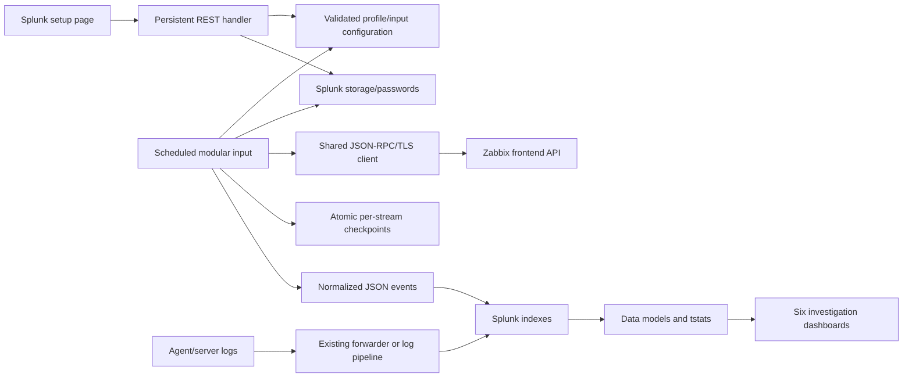

# Architecture and how the app was built

The starting point was a small Zabbix audit collector. Its fixed URL suffix, body-based token authentication, fixed row cap and timestamp-only progress tracking made useful design questions visible: how does an operator know the endpoint is right, whether a response was truncated, and which authentication behavior a newer Zabbix release accepts?

Zabbix Vision is an original implementation. The reference repository was inspected for behavior; its source is not copied or bundled. The runtime uses Python's standard library and the APIs bundled with Splunk. It does not use UCC, a bundled HTTP library, an automatic Python search lookup or an external database.

## Runtime layers

1. **Configuration:** `bin/zabbix_vision_lib/config.py` validates names, URL paths, IDs, transport controls and input scopes. Both REST configuration and runtime collection use the same validation.
2. **Transport:** `client.py` discovers version, chooses authentication, constructs a verified SSL context, bounds response size, refuses redirects and applies bounded read retries.
3. **Collection:** `collector.py` separates current snapshots from time-based records. Time ranges split when a row threshold is reached; saturated single seconds fail with the checkpoint retained. Snapshot completion markers make an empty successful inventory visible.
4. **Normalization:** `normalize.py` gives records stable fields and event identities while retaining a structured redacted source payload. History identities include nanoseconds and value type. Known secret keys and script-output fields are redacted; arbitrary business secrets embedded in command text still require source-side policy.
5. **Splunk integration:** `splunk_store.py` uses app-scoped config and native credential endpoints; `zabbix_vision.py` implements the modular input. `zabbix_vision_manager.py` handles setup/test and explicitly enabled execution using the caller's session.
6. **Search:** native props/transforms, eventtypes and tags expose searchable fields. Two custom data models serve count/trend panels; raw searches retain long details and current-snapshot logic.

## Security decisions

Splunk owns encryption. Tokens and optional key passphrases use `storage/passwords`; the app checks the observed cipher prefix without returning secret material. New writes use the platform's `$8$` format on 10.6+ and `$7$` before that. Existing secrets need Splunk's migration procedure after upgrades; this app does not reimplement encryption.

Setup requires `admin_all_objects`. Script execution additionally requires `zabbix_execute_scripts`, a profile execution switch, explicit script and host allowlists, and `EXECUTE` confirmation. The predefined script lives in Zabbix. Requests are audited before execution; output is suppressed and execution is never retried automatically. Zabbix independently enforces token/host/script permissions.

## Development and evidence

Development used local protocol/checkpoint/security tests, then disposable official Zabbix 6.0, 7.0 and 7.4 stacks against Splunk Enterprise 10.4.1. Live tests exposed native input-enable API behavior, profile boolean formatting, snapshot search semantics and script output inside audit details. Those findings informed the final implementation and regression tests.

The result is tested behavior with explicit limits, rather than a claim that every API or every host process is visible. See [validation](VALIDATION.md), [coverage](COVERAGE.md) and [build/release](BUILD.md).
